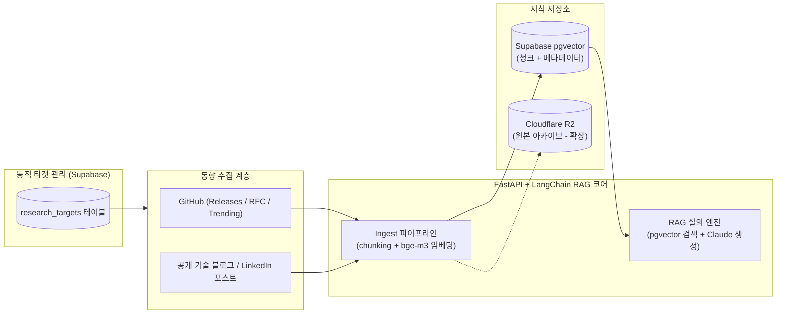

# assist — 개인 개발업무 동향 리서치 & RAG 어시스턴트 계획서

## 1. 프로젝트 개요

`assist`는 급변하는 **AI 코딩 에이전트/LLM**, **풀스택 웹 프레임워크**, **인프라 & DevOps** 생태계의 최신 동향(GitHub 릴리스 노트, RFC/디스커션, 트렌딩 저장소, 공개 기술 포스트 등)을 수집하여 지식 베이스에 적재하고, 개발 업무 중 필요한 아키텍처·기술 의사결정에 즉시 활용할 수 있도록 질의응답(RAG)을 제공하는 개인 개발 어시스턴트 백엔드 프로젝트입니다.

1회성 리포트 생성에 그치지 않고, **수집 대상(Research Targets)을 DB에서 동적으로 추가·관리**하며 지속적으로 지식을 축적·검색하는 파이프라인을 구축합니다.

---

## 2. 시스템 아키텍처 및 기술 스택

| 계층 | 선택 기술 | 선정 사유 |
|---|---|---|
| **API 게이트웨이 & 런타임** | Python 3.12 + **FastAPI** (`uvicorn`) | LangChain/임베딩 코어가 Python 런타임을 사용하므로 별도 Node 게이트웨이 없이 단일 런타임으로 운영 복잡도 최소화 |
| **RAG 오케스트레이션** | **LangChain (Python)** | 문서 분할, 벡터 스토어(`langchain-postgres`), 로컬 임베딩(`langchain-huggingface`), LLM(`langchain-anthropic`) 통합 성숙도 최고 |
| **관계형 & 벡터 DB** | **Supabase (PostgreSQL + `pgvector`)** | 동적 리서치 타겟 테이블(`research_targets`)과 벡터 임베딩/메타데이터 검색을 단일 DB에서 일관되게 처리 |
| **임베딩 모델** | **`BAAI/bge-m3`** (`sentence-transformers`) | API 키/비용 없이 로컬에서 구동 가능하며, 한국어·영어 다국어 검색 성능 및 생태계 안정성이 검증된 오픈소스 모델 |
| **답변 생성 LLM** | **Claude** (`langchain-anthropic`) | 수집된 기술 문서·릴리스 노트의 맥락 합성 및 출처 기반 근거 요약에 최적화 |
| **원본 스토리지 (확장)** | **Cloudflare R2** (S3 호환) | 대용량 원본 문서·아카이브 스냅샷 보관용 (벡터 검색은 Supabase `pgvector`가 전담) |



---

## 3. 리서치 대상 도메인 및 동적 타겟 관리 설계

### 3.1 초기 시드(Seed) 3대 리서치 도메인

어시스턴트가 기본으로 추적할 초기 리서치 대상 영역은 아래 3개 도메인으로 구성하며, 운영 중 언제든 새 도메인이나 타겟을 DB에 추가할 수 있습니다.

1. **`ai_agent_llm` (AI 코딩 에이전트 & LLM)**
   - **주요 타겟**: Claude Code, Google Gemini / Antigravity(AGY), OpenAI Codex, MCP (Model Context Protocol), LangChain / LangGraph
   - **수집 초점**: 에이전트 런타임/스킬/훅 규격 변화, MCP 서버 생태계, 모델 릴리스 및 코딩 벤치마크/프롬프트 패턴
2. **`fullstack_web` (풀스택 웹 프레임워크)**
   - **주요 타겟**: React, Next.js (App Router), NestJS, TypeScript 런타임 및 번들러(Turbopack, Vite, Rspack, Vitest 등)
   - **수집 초점**: 메이저/마이너 릴리스 노트, 캐싱/렌더링 아키텍처 변화, LLM/RAG 백엔드 연동 패턴 및 AI UI 라이브러리(`assistant-ui`, Vercel AI SDK 등)
3. **`infra_devops` (인프라 & DevOps)**
   - **주요 타겟**: Kubernetes, Terraform / IaC, Docker / 컨테이너 런타임, CI/CD (GitHub Actions 등), Cloudflare (Workers / R2 / Zero Trust), 관측성(OpenTelemetry / Prometheus / Grafana)
   - **수집 초점**: 프로비저닝·배포 자동화 패턴, 보안/시크릿 게이트, 클라우드 네이티브 운영 동향

### 3.2 동적 리서치 타겟 스키마 (`research_targets`)

리서치 대상을 코드에 하드코딩하지 않고 Supabase 테이블로 관리하여 API/CLI를 통해 자유롭게 추가·수정·비활성화합니다.

```sql
CREATE TABLE IF NOT EXISTS research_targets (
    id UUID PRIMARY KEY DEFAULT gen_random_uuid(),
    domain TEXT NOT NULL,                -- 예: 'ai_agent_llm', 'fullstack_web', 'infra_devops'
    name TEXT NOT NULL,                  -- 예: 'Next.js', 'Claude Code', 'Terraform'
    source_type TEXT NOT NULL,           -- 'github_repo' | 'search_query' | 'rss_or_url'
    source_config JSONB NOT NULL,        -- 예: {"repo": "vercel/next.js", "track": ["releases", "discussions"]}
    is_active BOOLEAN NOT NULL DEFAULT TRUE,
    last_collected_at TIMESTAMPTZ,
    created_at TIMESTAMPTZ NOT NULL DEFAULT NOW(),
    UNIQUE (domain, name, source_type)
);
```

### 3.3 벡터 문서 메타데이터 규격

`pgvector`에 적재되는 각 문서 청크(`Document.metadata`)는 검색 시 도메인·타겟별 필터링과 출처 추적이 가능하도록 아래 표준 필드를 포함합니다.

- `domain`: 리서치 도메인 식별자 (`ai_agent_llm`, `fullstack_web`, `infra_devops` 등)
- `target_name`: 대상 기술/프레임워크 이름 (`Next.js`, `NestJS`, `React`, `Claude` 등)
- `source_url`: 원문 URL (GitHub Release/PR/Discussion 또는 블로그 링크)
- `source_type`: `github_release` | `github_discussion` | `research_report` | `article`
- `published_at`: 원문 게시일 또는 수집 기준일 (ISO-8601)
- `chunk_index`: 원본 문서 내 청크 순번

---

## 4. TDD 기반 단계별 구현 로드맵

프로덕션 코드는 전역 TDD 규율(`change-flow` §②)에 따라 **실패하는 테스트를 먼저 작성한 뒤 구현**합니다.

### Phase 1 — 코어 Ingestion 파이프라인 (MVP 1단계)
1. **환경 및 설정 (`app/config.py`)**:
   - `pydantic-settings` 기반 환경변수 로드 (`SUPABASE_DB_URL`, `ANTHROPIC_API_KEY`, `EMBEDDING_MODEL_NAME="BAAI/bge-m3"`, `VECTOR_COLLECTION_NAME="tech_trends"`)
2. **텍스트 청킹 (`tests/test_chunking.py` → `app/chunking.py`)**:
   - `chunk_text(text, metadata, chunk_size, chunk_overlap)`: 빈 문자열 처리, 긴 텍스트 분할 및 오버랩 보장, 원본 메타데이터(`domain`, `target_name`, `source_url`) 및 `chunk_index` 보존 검증
3. **문서 적재 오케스트레이션 (`tests/test_ingest.py` → `app/ingest.py`)**:
   - `ingest_document(...)`: 문서를 청크로 분할한 뒤 VectorStore 인터페이스(`add_documents`)로 전달하는 파이프라인 (단위 테스트는 외부 DB/모델 의존성 없이 Fake VectorStore로 검증)

### Phase 2 — 동적 타겟 관리 & RAG 질의응답 API (MVP 2단계)
1. **동적 리서치 타겟 모듈 (`tests/test_targets.py` → `app/targets.py`)**:
   - 3대 도메인 기본 시드 정의 및 타겟 등록·조회·활성 상태 변경 로직
2. **RAG 검색 및 답변 체인 (`tests/test_rag.py` → `app/rag.py`)**:
   - 도메인/타겟 필터링을 지원하는 VectorStore 검색기(Retriever) + 출처(`source_url`) 인용을 강제하는 Claude 프롬프트 체인
3. **FastAPI 게이트웨이 (`tests/test_api.py` → `app/main.py`)**:
   - `GET /health`: 헬스체크
   - `GET /targets`, `POST /targets`, `PATCH /targets/{id}`: 리서치 대상 동적 관리
   - `POST /ingest`: 수집된 마크다운/텍스트 동향 문서 적재
   - `POST /query`: 도메인/키워드 필터 기반 RAG 질의응답 및 참조 출처 반환

### Phase 3 — 자동 수집기(Collectors) & 초기 시드 적재 (MVP 3단계)
1. **사전 리서치 시드 적재 스크립트**: 아래 §5의 사전 검증된 풀스택 동향 리포트를 초기 지식 베이스로 적재
2. **GitHub / 공개 검색 수집기 (`app/collectors/`)**:
   - 활성화된 `research_targets`를 순회하며 GitHub API(릴리스 노트·디스커션) 및 웹 검색 결과를 수집해 `/ingest` 파이프라인에 자동 공급

---

## 5. 사전 리서치 시드 데이터 요약 (2025~2026 풀스택 웹 동향)

0번 윈도우 세션에서 교차 검증(3-vote adversarial verification)을 완료한 `fullstack_web` 도메인 핵심 동향 요약입니다. Phase 3에서 최초 시드 문서로 DB에 적재됩니다.

### 5.1 Next.js 16 (16.0 ~ 16.3)
- **명시적 캐싱 전환 (`Cache Components`)**: 기존 App Router의 암묵적 캐싱과 실험적 `ppr`/`dynamicIO` 플래그를 단일 `cacheComponents` 설정 및 `"use cache"` 디렉티브(Opt-in)로 통합 ([Next.js 16 블로그](https://nextjs.org/blog/next-16)).
- **네이티브 DevTools MCP 서버 탑재**: `/_next/mcp` 엔드포인트를 통해 AI 코딩 에이전트에게 라우팅/캐싱/렌더링 컨텍스트, 브라우저+서버 통합 로그(`get_logs`), 에러 스택트레이스(`get_errors`), 페이지 메타데이터(`get_page_metadata`)를 직접 노출 ([Next.js MCP 가이드](https://nextjs.org/docs/app/guides/mcp)).
- **`updateTag()` 및 Rust 기반 React Compiler**: Server Actions 내 즉시 만료·재조회(read-your-writes)를 보장하는 `updateTag()` 추가 및 `turbopackRustReactCompiler` 옵션을 통한 빌드 속도 20~50% 개선 ([Next.js 16.3 블로그](https://nextjs.org/blog/next-16-3-turbopack)).
- **LLM/RAG 백엔드 연동 표준**: Server Actions 대신 **App Router Route Handlers (HTTP + SSE)**를 통해 Python FastAPI / LangChain / LangGraph 백엔드와 스트리밍 통신하는 패턴이 표준으로 자리잡음.
- **AI SDK RSC 공식 중단**: 기존 서버 컴포넌트 스트리밍 방식의 Generative UI(`AI SDK RSC`)는 스트림 중단 불가·깜빡임·전송 오버헤드 문제로 개발이 일시 중단(paused)되었으며, `AI SDK UI`로의 마이그레이션이 공식 권장됨 ([AI SDK 마이그레이션 가이드](https://ai-sdk.dev/docs/ai-sdk-rsc/migrating-to-ui)).

### 5.2 NestJS 12
- **ESM 전면 전환 및 Standard Schema 지원**: 공식 패키지 전체를 CommonJS에서 ESM(`require(esm)` 호환, Node 20.19+/22.12+ 요구)으로 전환하고, 데코레이터에서 `Standard Schema`를 지원하여 `class-validator` 대신 `Zod`, `Valibot`, `ArkType`을 직접 사용할 수 있음 ([NestJS PR #16391](https://github.com/nestjs/nest/pull/16391)).
- **RAG 아키텍처 패턴**: Postgres + `pgvector`를 기반으로 OpenAI / Anthropic / Gemini 등 멀티 프로바이더를 플러그형으로 교체하는 모듈 구조가 주로 활용됨.

### 5.3 React AI UI 생태계
- **`assistant-ui`의 표준 부상**: Radix 스타일의 헤드리스 컴포넌트(`Thread`, `Composer`, `Message`)를 제공하며 LangGraph, LangChain, Vercel AI SDK 어댑터를 공식 지원하는 React 채팅/어시스턴트 UI 표준 라이브러리로 자리잡음.
- **Vercel AI SDK v7**: ESM 전용(Node 22+)으로 전환되었으며, 트랜스포트 기반 `useChat` 아키텍처(`DefaultChatTransport`)와 에이전트 루프용 `ToolLoopAgent` / `WorkflowAgent` 프리미티브를 도입함 ([Vercel AI SDK 7 Changelog](https://vercel.com/changelog/ai-sdk-7)).
